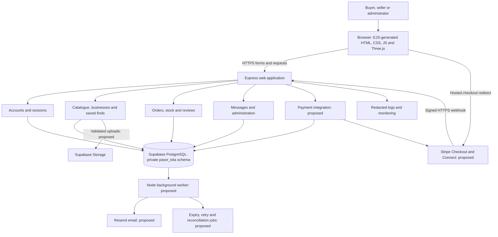
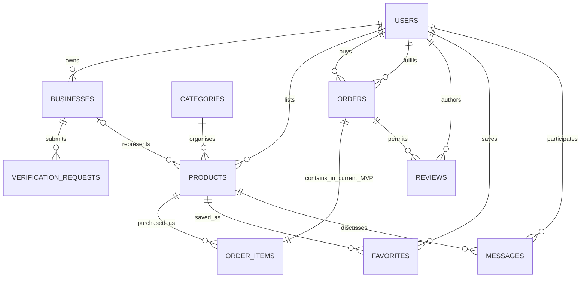
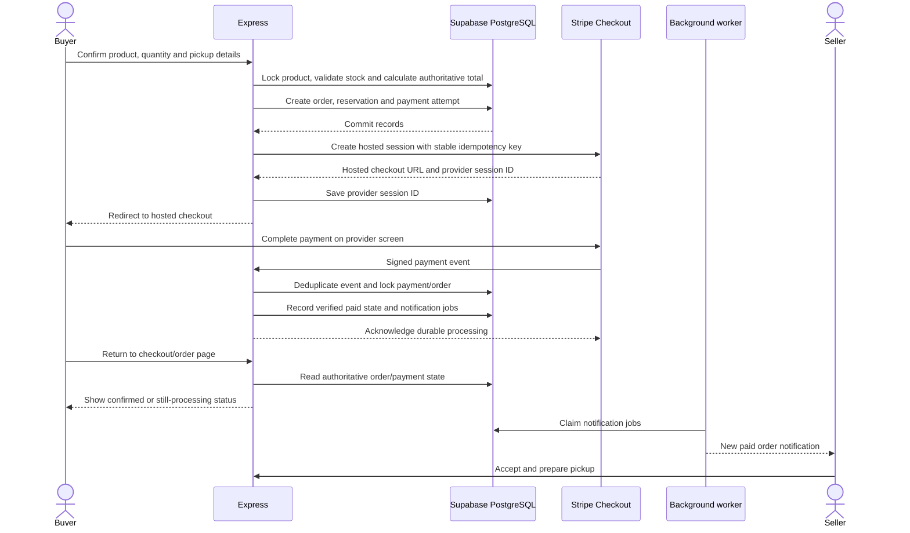
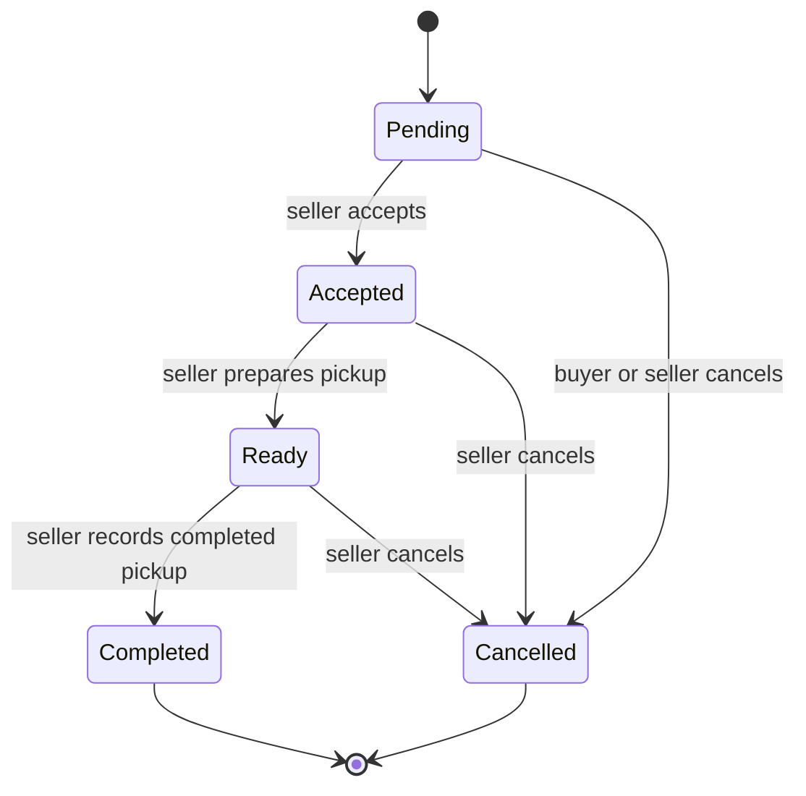
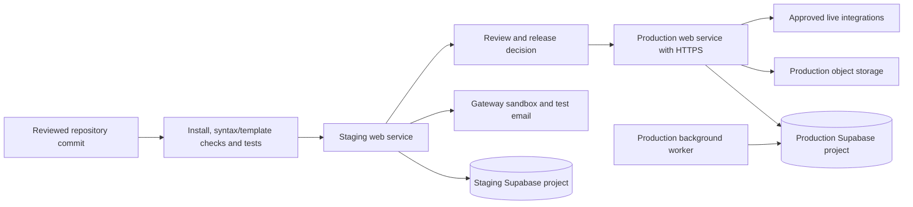

# Pasor Kita: complete system architecture

**Project:** A campus e-commerce marketplace for the UTHM community.  
**Course:** BIK20404 Web Development, Semester 1, 2026/2027.  
**Updated:** 3 November 2026, Malaysia time.  
**Selected foundation:** Node.js, Express, EJS, Supabase PostgreSQL and Three.js.

This document describes the full journey from building the application to operating a marketplace with online payments. It distinguishes the **implemented coursework application** from the **recommended production extensions**. It is a technical design proposal, not evidence that payment, email, hosting or storage accounts have already been connected.

## 1. Recommended approach

Use one Express application with clearly separated modules, a PostgreSQL database on Supabase, and a small background worker when external services are added. EJS renders the pages. Browser JavaScript handles progressive enhancement, while Three.js provides the decorative interactive scene. Keep checkout, permissions and all authoritative data changes on the server.

For the assessed project, demonstrate a complete product-to-pickup workflow first. Add **Stripe Checkout in a sandbox** as the next payment milestone. A real marketplace with independent sellers needs **Stripe Connect**, supported seller onboarding and an explicitly chosen funds flow before live transactions. A single platform payment account is insufficient as a model for automatically paying unrelated sellers. [Stripe Connect overview](https://docs.stripe.com/connect)

### Recommended service choices

| Responsibility | Recommended choice | Why it fits | Current status |
| --- | --- | --- | --- |
| Application runtime | Node.js 22 or later | Shared JavaScript across server and browser | Implemented |
| HTTP server and routing | Express 5 | Explicit authentication, CRUD and order logic for assessment | Implemented |
| HTML rendering | EJS | Preserves existing HTML/CSS and shared page layouts | Implemented |
| Design and interaction | Existing local CSS/SVG assets and browser JavaScript | Retains the Pasor Kita identity | Implemented, browser QA pending |
| 3D scene | Three.js, served locally | Keeps the 3D direction without a client framework | Implemented, WebGL rendering not visually verified here |
| Database | Supabase PostgreSQL | Shared relational records, constraints and transactions | Adapter/schema implemented, live connection pending |
| Accounts | Express authentication, bcrypt and PostgreSQL sessions | Matches the current implementation and demonstrates backend processing | Implemented |
| Image storage | Supabase Storage | Durable storage for published product photos | Proposed; current uploads are local files |
| Payment gateway | Stripe Checkout, sandbox first | Hosted payment form and server-side payment confirmation | Proposed |
| Seller payment routing | Stripe Connect | Models independent sellers and their payment accounts | Proposed, subject to account/capability eligibility |
| Malaysian bank payment method | FPX through Stripe where eligible | A locally relevant payment option | Proposed and conditional |
| Transactional email | Resend | Registration verification, recovery and order notifications | Proposed |
| Messages | PostgreSQL messages through Express | Keeps authorisation with the app's existing sessions | Implemented with page refresh |
| Hosting | Render Node web service | Runs a persistent Express server | Proposed, not deployed |
| Background work | Node worker using a PostgreSQL outbox/jobs table | Retries external tasks without needing Redis initially | Proposed |
| Monitoring | Host logs, health checks and an error tracker | Finds failures in checkout, jobs and integrations | Health endpoint implemented; external monitoring proposed |

This is a recommendation for this project's scale. It does not require separate microservices, a Kubernetes cluster, a second database or a dedicated search provider.

## 2. Overall architecture



The browser never receives a database password, Stripe secret key or storage administration key. It receives only the HTML and the public data needed for the current page. An online payment happens on the gateway's hosted screen. Pasor Kita records the provider reference and status, rather than card numbers or bank credentials.

## 3. Application structure

The implementation currently has this structure:

```text
pasorkita_bik20404/
  server/
    index.js                  # Local server and session cleanup
    app.js                    # Express middleware, routes and permissions
    config.js                 # Environment, TLS and session-secret settings
    db.js                     # PostgreSQL pool, transactions and session store
    domain.js                 # Input, money, order and review rules
    catalogue.js              # Parameterised catalogue queries
    seed.js                   # Explicit demo-data seeding
  views/
    layout.ejs                # Shared shell and navigation
    partials/                 # Artwork, product cards, forms and campus card
    pages/                    # Distinct content page templates
  public/
    assets/                   # Existing photos, original artwork and fonts
    refinements.css           # Responsive and readability refinements
    ui.js                     # Forms, saved items, card interaction and PWA
    scene.js                  # Three.js scene with a visual fallback
    sw.js                     # Public assets and offline fallback only
  database/
    schema.sql                # Supabase-compatible PostgreSQL schema
    sample-products.json      # Labelled sample catalogue
  scripts/
    setup-database.mjs
    check-project.mjs
    launch-local.mjs
  tests/                      # Disposable PostgreSQL and HTTP checks
  docs/                       # Proposal, setup, architecture and archive
```

Before introducing payments, split the routes in `app.js` into `auth`, `catalogue`, `seller`, `orders`, `messages`, `payments` and `admin` modules. Add service functions for payment state and inventory reservations. This is a proposed code organisation change; those separate modules do not already exist.

## 4. Users and permissions

| Actor | Access |
| --- | --- |
| Visitor | Browse listings, read product details and use the guide |
| Registered member as buyer | Save products, message a seller, place orders and review completed exchanges |
| Registered member as seller | Manage owned listings, linked businesses and incoming orders |
| Administrator | Manage categories, moderate listings/reviews and decide registration requests |
| Background worker | Perform a bounded set of scheduled/retry operations without acting as a browser user |
| Payment provider | Deliver signed events to a dedicated integration endpoint |

Buyer and seller are activities of one member account. A member does not gain administrator access by changing a form field. Business identity is an ownership relationship, not a second university login.

The app checks resource ownership on every protected write. In production, also record an audit entry for administrator decisions, refunds and changes to a seller's payment destination.

## 5. Page map and PDF alignment

The coursework version has **14 distinct page purposes**, matching the PDF's limit of 7-14. The product editor's new/edit routes are variants of one page purpose. Filters and product IDs do not inflate the count.

| No. | Page | Main purpose |
| --- | --- | --- |
| 1 | Home | Introduce the marketplace and featured products |
| 2 | Marketplace | Browse, search, filter and sort |
| 3 | Product details | Read price, condition, pickup information and reviews |
| 4 | Registration | Create a Pasor Kita account |
| 5 | Login | Authenticate a member |
| 6 | Account | Edit profile, view the 3D card and manage businesses |
| 7 | Seller studio | Manage listings and incoming orders |
| 8 | Product editor | Create or update a listing |
| 9 | Saved finds | Manage a saved collection |
| 10 | Checkout | Confirm quantity, total and pickup details |
| 11 | My orders | Track orders and write eligible reviews |
| 12 | Administration | Manage categories and moderate content |
| 13 | Help | Explain the service through an accessible animated guide |
| 14 | Messages | Exchange messages with a seller or buyer |

Add future payment status, refunds and seller onboarding within the existing checkout/account/order pages. The external hosted payment screen is outside the site's own content map. Revisit the page map with the lecturer if the group adds new standalone content pages.

The site uses HTML/CSS/JavaScript, a real backend, related tables, CRUD, security checks and responsive layouts. Five or more relevant product images are retained. The help animation has readable steps, reduced-motion support and a pause control. The assignment source is [the supplied brief](../project-proposal/sources/assignment-brief.pdf). The final report still needs the required academic references, implementation explanations and final demonstration evidence.

## 6. Database model

### Implemented tables

All implemented application tables live in the **`pasor_kita`** schema.

| Table | Purpose | Main relationships |
| --- | --- | --- |
| `users` | Name, university email, password hash, campus and role | Owns listings/businesses and participates in orders |
| `categories` | Catalogue organisation and category icon | Referenced by products |
| `businesses` | Business identities linked to a member | `owner_id` references users |
| `verification_requests` | Separate SSM/PTU references and decisions | References a business and reviewing administrator |
| `products` | Description, price, available stock and image path | References seller, category and optional business |
| `orders` | Buyer, seller, pickup details, total and fulfilment status | References both counterpart users |
| `order_items` | Purchased title, quantity and unit price snapshot | References the order and product |
| `reviews` | Item, seller and buyer feedback | References the completed order, author and target |
| `favorites` | Saved products | Unique user/product pair |
| `messages` | Persisted product conversations | References product, sender and recipient |
| `sessions` | Server-side browser sessions and expiry | Cookie contains an opaque session identifier |



Current checkout contains one product per order and one seller. A future cart should group items by seller into separate orders unless a deliberate multi-seller settlement model replaces this rule.

### Proposed additional records for production services

| Record/table | Suggested fields | Reason |
| --- | --- | --- |
| `action_tokens` | user, purpose, token hash, expiry, used time | Single-use email verification and recovery |
| `payment_attempts` | order, provider, session/intent ID, amount in sen, currency, state, idempotency key | Reliable gateway integration and retries |
| `gateway_events` | unique provider event ID, received time, processing state | Deduplicate webhook delivery and retain audit evidence |
| `refunds` | payment attempt, provider refund ID, amount, reason, status | Track refunds independently from orders |
| `seller_payment_accounts` | user/business, connected account ID, capability status | Route payment only to the verified seller account |
| `inventory_reservations` | order, product, quantity, expiry, release/consume state | Coordinate payment deadlines and prevent double stock release |
| `outbox_jobs` | kind, record reference, attempt count, next retry, lease, result | Durable asynchronous work |
| `notifications` | recipient, type, record reference, read time | In-app alerts without relying solely on email |
| `order_status_history` | order, previous/new state, actor, timestamp | Explain and audit order transitions |
| `audit_logs` | action, actor, target, redacted change summary | Trace administration and sensitive operations |
| `reports` | reporter, listing/review/message, reason, decision | Structured abuse reports |

Enforce foreign keys, unique payment references, unique review targets and non-negative stock. Keep agreed unit prices and product titles with order items. Archive products referenced by orders rather than deleting historical purchase records.

## 7. Account lifecycle

### Current flow

1. Member enters name, university email, password and campus.
2. Express validates the exact allowed domain, password length and submitted values.
3. The server hashes the password and inserts an ordinary member record.
4. Express regenerates the session identifier and stores the session in PostgreSQL.
5. The browser receives an HttpOnly, SameSite session cookie.
6. Each protected request loads the member and checks the operation's permissions.
7. Logout destroys the database-backed session.

### Recommended public-launch extension

1. Create the account with `email_verified=false` and restricted selling/payment access.
2. Generate a random verification token, store its hash with an expiry, and enqueue an email.
3. Send the confirmation link through Resend. When opened, validate and consume the token once.
4. Set email ownership as verified. Treat this as evidence of mailbox control only.
5. For recovery, issue a separate single-use reset token, replace the password hash and invalidate existing sessions when appropriate.
6. If official UTHM SSO becomes available with university approval, introduce it as a planned identity migration. Do not claim a campus email form already provides official university authentication.

Keep Express authentication as the single identity system for this implementation. Supabase is currently the database provider. Supabase Auth is a possible later alternative, but enabling it would require a deliberate user-ID/session migration. Do not maintain two unrelated password databases for the same account.

## 8. Seller and product lifecycle

1. A signed-in member optionally creates a linked business.
2. The member creates a product with an image, category, price, stock, campus and pickup point.
3. The server derives `seller_id` from the session and verifies ownership of any selected business.
4. The app validates form fields and the upload before saving.
5. A published listing appears in the shared catalogue.
6. The owner can edit or remove it. Historical order references survive removal.
7. A business can request separate SSM and PTU reviews. Only an administrator's evidence review can approve those badges.

For the public version, move product images to object storage. Store an object path in the product record rather than a base64 image or a machine-specific local path. If a later database write fails, mark the new object for orphan cleanup.

Services and rentals remain discoverable in the existing categories. The current order flow records a quoted listing purchase, not a full booking/calendar/deposit system. Add service deliverables, rental duration, deposit/return rules and availability constraints before presenting those as automated workflows. Product sales with campus pickup form the assessed core.

## 9. Search, saved finds and recommendations

The implemented query supports product/seller text, category, campus, price and sorting, with bounded pagination. Saved finds use a unique user/product pair in PostgreSQL.

Use ordinary PostgreSQL indexes for this project. Introduce full-text search and keyset pagination only when catalogue size and measured query performance justify them. Keep the sales chart based on completed orders. Do not derive sales from review counts or fabricate popularity numbers.

## 10. Payment gateway selection

### Recommended choice: Stripe Checkout, then Connect

For the next demonstration milestone, use a Stripe sandbox and a hosted Checkout page. Keep the Pasor Kita website design around the redirect and return page. The gateway's own payment form has its own supported branding controls.

For a live platform serving independent sellers, add Connect onboarding and verified payment accounts. Determine the supported countries, capabilities, seller types and platform arrangement before offering online payment to a seller. Sellers who cannot meet the provider's requirements can remain on payment on pickup. [Connect account capabilities](https://docs.stripe.com/connect/account-capabilities)

FPX is a Malaysian bank-redirect payment method with MYR support. Stripe's current FPX documentation includes Malaysian business eligibility and a Business Registration Number requirement. Therefore, a university email or Pasor Kita profile does not automatically qualify a student to accept FPX. Enable it only when the actual account arrangement is eligible. [Stripe FPX requirements](https://docs.stripe.com/payments/fpx)

### Why not collect every seller's money in one ordinary merchant account?

Pasor Kita is a marketplace. The system needs to identify which seller supplies an order and where the proceeds belong. Choose the provider's supported marketplace model for that funds flow. Keep collection, seller transfers and bank payouts as separate records and states.

For the current one-seller-per-order model, **destination charges are one candidate**. They can transfer funds to the connected account at payment time, and the platform bears provider-described fees/refund/chargeback responsibilities. This does not itself mean that money is held until campus pickup. Confirm the charge type against the actual business arrangement before implementing it. [Stripe destination charges](https://docs.stripe.com/connect/destination-charges)

If the intended policy requires delayed seller settlement after pickup, design that flow separately with a supported Connect arrangement and the provider's approval. Do not label a simple checkout integration as an escrow service.

### Alternative to evaluate

Billplz is a relevant Malaysian alternative. Its API documents payment collection and split rules. Evaluate those facilities together with its seller settlement, refund and verification requirements against the final project scope. Collection and split rules should not be assumed to settle every marketplace payout requirement automatically. Select one gateway for the first integration rather than implementing both. [Billplz API](https://support.billplz.com/api)

Do not hard-code current fees or promise free processing. Keep provider fees and any platform commission configurable after confirming the actual account's pricing. For an academic sandbox, a platform commission can remain zero.

## 11. Online checkout, from beginning to end

The following flow is **proposed**. Current checkout uses payment on pickup and does not call Stripe.



### Transaction boundaries

1. Begin a short database transaction, lock the product, check availability and snapshot the price.
2. Create the order, reservation and payment-attempt reference, then commit.
3. Call the external gateway **after** committing. Do not hold a product lock while waiting on the gateway's network response.
4. Save the returned provider reference in a second short transaction.
5. If the external call times out, retry the same payment attempt using its stable idempotency key. Reconcile an uncertain outcome instead of creating a second unrelated charge. [Stripe idempotent requests](https://docs.stripe.com/api/idempotent_requests)

### Rules the server must enforce

- Obtain the current price and seller destination from the database. Never trust submitted totals, fee amounts or payout account IDs.
- Convert the MYR amount into integer sen for the provider. Store currency explicitly.
- Bind a payment attempt to exactly one order and its owning buyer.
- A repeated checkout submission with the same checkout key reuses the existing attempt.
- A return URL is a navigation result. The server determines whether the payment is confirmed.
- Reserve stock with a defined expiry coordinated with the gateway's supported checkout deadlines.
- Allow only the provider-confirmed paid state to unlock fulfilment for online-payment orders.

Use provider webhooks to make fulfilment reliable even if a buyer never reaches the success page. [Stripe Checkout fulfilment](https://docs.stripe.com/checkout/fulfillment.md?ui=full-page)

## 12. Webhook security and reliability

Proposed endpoint: `POST /integrations/stripe/webhook`.

The route must use the original raw request body and the endpoint's signing secret. Mount its raw-body handling before general JSON parsing. Verify the provider signature before processing; a browser-supplied “paid” field is insufficient. The provider webhook uses signature authentication rather than a browser session/CSRF token. [Stripe webhook signature verification](https://docs.stripe.com/events/manage-webhook-endpoints#signature-errors)

Recommended processing design:

1. Accept only the intended endpoint/method with a bounded payload size.
2. Verify the signature and intended sandbox/live environment.
3. Insert the unique provider event ID into `gateway_events`.
4. Resolve the order from a saved provider payment reference. Check amount, currency and seller context.
5. Lock the payment/order records and apply an allowed state transition once.
6. Save the event result and create notification jobs in the same transaction.
7. Acknowledge only after the event or its durable processing job is saved.
8. On temporary failures, allow retry. On duplicate delivery, return a successful acknowledgement without repeating stock or notification actions.
9. Handle events arriving out of order by checking current provider/payment state rather than assuming event order.

The database event uniqueness constraint and state transition checks are still required even when the provider API uses idempotency keys. They protect different boundaries.

## 13. Order, payment and inventory state

### Current pickup-order states



Current behaviour: stock is reserved on order creation. A valid cancellation restores it once. A completed/cancelled order cannot repeat that transition. Reviews require completion.

For the production version, add buyer pickup confirmation or a one-time pickup code and an audit trail. Do not use payment success alone as proof that a physical pickup occurred.

### Proposed separate state fields

| Concern | Example states |
| --- | --- |
| Order/fulfilment | pending seller, accepted, ready for pickup, completed, cancelled |
| Payment | awaiting payment, processing, paid, failed, refund pending, partially refunded, refunded |
| Inventory reservation | reserved, consumed, released, expired |
| Seller transfer | not applicable, pending, transferred, reversed |
| Bank payout | pending, paid out, failed |

Keep these independent. An order may have a successful payment but still await pickup. A cancelled paid order may require a refund. A successful customer payment does not prove that the seller's bank payout has completed.

### Expiry and race conditions

- A worker identifies expired unpaid reservations and locks them before releasing stock.
- It verifies the provider payment/session outcome when that outcome is uncertain.
- Expiry and payment confirmation use the same reservation transition rules.
- If a late successful payment arrives after stock was released, route it to reconciliation. Re-reserve only if safe, otherwise initiate the defined refund workflow. Never silently fulfil an oversold order.
- Use unique business-operation keys for stock release, notification and refund jobs.
- Current pickup orders do not have automatic expiry; that worker is a proposed extension.

## 14. Cancellations, refunds and seller payouts

For online payments, cancellation and refund are different operations. A cancellation changes fulfilment. The refund record tracks the actual money operation.

Recommended flow:

1. The buyer requests cancellation through their order page.
2. The server checks policy, ownership, fulfilment state and refundable balance.
3. Record a refund request with a stable operation key and audit entry.
4. A worker calls the provider and records the refund reference.
5. Confirm the result through the provider's documented status/events. Show pending while unresolved.
6. Prevent cumulative refunds exceeding the paid amount.
7. For marketplace payments, handle the chosen charge type's seller transfer/application-fee treatment explicitly. Do not assume a customer refund automatically recovers previously transferred seller funds. [Stripe refund behaviour](https://docs.stripe.com/refunds)

Seller onboarding should store only provider account IDs and capability status in Pasor Kita. Use the provider's onboarding experience for sensitive bank and identity information where supported. SSM/PTU content badges remain distinct from the payment provider's merchant verification.

For coursework, demonstrate these ideas in a sandbox. Enabling real payments, payouts or paid subscriptions requires a separately configured provider account and the final business arrangement.

## 15. Storage and multimedia

### Current implementation

Relevant product photos, original SVG artwork and fonts are served locally. Uploads accept one JPEG, PNG or WebP with a 4 MB limit, server-generated filenames and signature/type checks. Local files are adequate for the localhost demonstration.

### Recommended hosted implementation

| Storage category | Proposed access | Content |
| --- | --- | --- |
| Product images | Public read if the photo is intentionally public; server-controlled write | Sanitised catalogue photos |
| Private business evidence | Private bucket and short-lived authorised download | Registration evidence needed for administrator review |
| Exports/receipts | Private where they contain personal/order details | Generated records requested by the account owner |

Supabase Storage supports access policies, and its service keys bypass those policies. Keep any service key exclusively on the server and enforce the member's ownership before using it. Public URLs must never be used for private registration documents. [Supabase Storage access control](https://supabase.com/docs/guides/storage/security/access-control)

Add full image decoding/re-encoding, dimension limits and metadata removal before accepting public production uploads. Keep object references and ownership in the database. Schedule orphan-object cleanup. Retain a readable guide and alt text, rather than making an animation the only source of instructions.

## 16. Email and in-app notifications

Resend is the recommended transactional sender. Its Node integration requires an API key and a verified sending domain. Store credentials in hosting secrets. Use a domain the group controls; a university recipient email does not grant permission to send mail from the university domain. [Resend Node.js setup](https://resend.com/docs/send-with-nodejs)

Proposed events:

| Trigger | Recipient | Delivery |
| --- | --- | --- |
| Account registration | Account email | Verification link |
| Recovery request | Account email | Single-use reset link |
| Order accepted or ready | Buyer | In-app notification and email |
| New order or cancellation | Seller | In-app notification and email |
| Payment/refund state change | Relevant buyer/seller | Status link and reference, without sensitive payment data |
| Registration decision | Business owner | Decision and next steps |

Write an outbox job in the same database transaction as the business event. Email failure must not undo a paid order. Retry bounded failures, keep delivery IDs and make duplicate jobs harmless. The order page remains the source of truth when email is delayed.

## 17. Messaging

The current application stores messages in PostgreSQL and returns only messages in which the signed-in member participates. A buyer can contact a product's seller. A seller can reply to an existing buyer conversation. Messages render as escaped text.

For the first public iteration, add bounded polling through an authenticated Express endpoint if necessary. That keeps the existing session model. Add conversation pagination, read status and report controls. A hosted realtime service can come later; do not expose private message tables directly to anonymous browser subscriptions.

Current messaging is persistent, but it is not instant push messaging and does not send email notifications yet.

## 18. Background jobs

Use one Node worker from the same repository. A PostgreSQL-backed jobs/outbox design is adequate at this scale.

| Job | Purpose |
| --- | --- |
| Email delivery | Retry transactional mail without blocking HTTP requests |
| Reservation expiry | Release unpaid stock under the same consistency rules as payment updates |
| Gateway reconciliation | Resolve uncertain payment, refund and payout outcomes |
| Orphan cleanup | Remove abandoned uploads after a safe grace period |
| Session/token expiry | Remove expired security records |
| Operational summaries | Produce aggregate health/sales information without fabricating transactions |

Workers claim jobs using row locking and a time-limited lease, with bounded attempts and a next-attempt timestamp. A job that repeatedly fails moves to a failed state for administrator review. Use `FOR UPDATE SKIP LOCKED` or equivalent transactional claiming so two workers do not perform the same pending job concurrently.

Only the periodic expired-session cleanup is implemented today. The general outbox worker is proposed. Render provides a background-worker service type suitable for this separate process. [Render background workers](https://render.com/docs/background-workers)

## 19. Security boundaries

### Implemented controls

- Parameterised PostgreSQL queries and database constraints.
- bcrypt password hashes and regenerated login sessions.
- HttpOnly, SameSite cookies, with Secure cookies for HTTPS production.
- CSRF tokens on state-changing browser forms.
- Role, participant and resource-ownership checks.
- Escaped EJS output for user-entered content.
- Authentication/message rate limits and bounded form/upload sizes.
- Content-security and other HTTP security headers.
- A private application schema and server-only database access.
- A service worker that avoids caching personalised pages or writes.

### Required production additions

- Email ownership verification, recovery and stronger administrator authentication.
- A least-privilege runtime database role separate from the migration owner.
- Shared rate-limit storage if more than one web instance serves requests.
- Secret rotation, redacted audit logs and restricted operational access.
- Provider-signature verification and replay protection for payment events.
- Image decoding and durable cloud object storage.
- Recovery/restore tests and application-level abuse reporting.

The current custom schema is not intended for Supabase's public Data API. If the architecture later allows direct browser access to tables, design the required grants and row-level policies first. Do not assume Express session identity automatically maps to Supabase `auth.uid()`.

## 20. Deployment and operations

### Development

1. Install the declared Node dependencies.
2. Configure `.env` with the intended Supabase development connection.
3. Run the explicit schema/seed command against the development project.
4. Start Express locally and demonstrate the complete buyer/seller workflow.
5. Run isolated tests before changing the shared development database.

Use Supabase's session pooler or direct connection according to your network and deployment. The code uses a small PostgreSQL connection pool and verifies hosted TLS certificates. [Supabase connection guidance](https://supabase.com/docs/guides/database/connecting-to-postgres)

### Proposed staging and production



Suggested Render configuration: install using `npm ci`, validate with `npm run check`, start with `npm start`, bind `HOST=0.0.0.0` and use the platform-provided `PORT`. Set `NODE_ENV=production`. Configure `TRUST_PROXY=1` only where the actual hosting path contains one trusted reverse proxy. Render documents deploying an Express web service with project-specific build/start commands. [Render Express deployment](https://render.com/docs/deploy-node-express-app)

Use a separate migration/release task. Do not run demo seeding on every server restart. Keep test/live payment keys and databases separate. A hosted filesystem must not be the only copy of uploaded media. This document proposes hosting; no public deployment has been performed.

### Proposed environment settings

| Variable | Purpose | Status |
| --- | --- | --- |
| `DATABASE_URL` | Server-side PostgreSQL connection | Implemented |
| `DATABASE_CA_CERT` | Optional trusted CA path for the database | Implemented |
| `SESSION_SECRET` | Cookie/session signing secret | Implemented |
| `HOST`, `PORT`, `NODE_ENV`, `TRUST_PROXY` | Server and trusted-proxy configuration | Implemented |
| `SEED_PASSWORD`, `SEED_ADMIN_EMAIL` | Explicit development seed | Implemented; omit from production |
| `APP_BASE_URL` | Canonical HTTPS link/redirect origin | Proposed |
| `SUPABASE_URL`, storage server credential | Cloud object operations | Proposed |
| `STRIPE_SECRET_KEY` | Server API access, sandbox first | Proposed |
| `STRIPE_WEBHOOK_SECRET` | Verify payment event signatures | Proposed |
| `RESEND_API_KEY`, `EMAIL_FROM` | Transactional sender | Proposed |
| Error-tracker settings | Production diagnostics | Proposed |

Only add variables once the corresponding integration is implemented. Do not place secret values in EJS output, public JavaScript, screenshots or documentation.

## 21. Monitoring and recovery

Current `/health` returns whether the Express application can query its application tables. It reports setup-required when the database is absent/unavailable. It does not disclose connection settings.

For production, monitor HTTP errors, database latency, outstanding reservations, webhook failures, unreconciled payments and job retries. Add request/order/payment reference IDs to logs. Redact passwords, session cookies, tokens, connection strings and private message content.

Back up both database records and stored media. Supabase's database backup availability depends on the plan, and database backups do not include Storage API object contents. Plan separate media backup/export and test restoration. [Supabase backup scope](https://supabase.com/docs/guides/platform/backups)

After a restore, reconcile orders/payments against the provider before resuming fulfilment. A restored database can be older than an actual customer payment. Record a recovery procedure and test it using staging data.

## 22. Delivery stages and acceptance criteria

| Stage | Deliverable | Acceptance criterion |
| --- | --- | --- |
| 1. Migration | Express/EJS foundation, retained design and Three.js | No active Next.js dependency or runtime, purposeful pages render |
| 2. Database | Supabase schema and runtime configuration | Live setup succeeds and records survive app restart |
| 3. Coursework workflow | Accounts, catalogue CRUD, orders, messages and reviews | Complete buyer/seller/admin journey and rejected unauthorised writes |
| 4. Visual review | Phone/desktop layouts and accessibility | Readable forms, keyboard navigation, five images and a pausable guide |
| 5. Cloud media/email | Durable objects, verification/recovery and notifications | Ownership checks, single-use tokens and retryable delivery |
| 6. Payment sandbox | Hosted checkout, webhook ledger and refunds | Duplicate/out-of-order/late events do not create duplicate fulfilment |
| 7. Marketplace funds flow | Eligible connected sellers and defined settlement | Seller destination is server-controlled and payout/refund rules are verified |
| 8. Hosted release | Staging, HTTPS, monitoring and backups | Recovery and integration tests pass against intended environments |

Migration code and isolated application checks are complete. Live Supabase validation, browser visual review and the proposed external integrations remain outstanding until the relevant access/settings and implementation are provided.

### Essential payment test cases for the next phase

- Successful sandbox payment, failed payment and abandoned checkout.
- Price/quantity tampering and buying an owned listing.
- Two buyers competing for the final unit on real PostgreSQL.
- Gateway timeout after creating a payment session, followed by a retry.
- Missing, duplicate, invalid-signature and out-of-order webhooks.
- Paid webhook arriving after a reservation's expiry.
- Full/partial refund and refund failure, without repeated stock release.
- Seller account ineligible or payout disabled.
- Return-page refresh without granting fulfilment twice.
- Notification failure while order/payment state remains correct.

## 23. A concise explanation for presentation

Pasor Kita uses a three-layer architecture. The browser displays EJS-generated HTML with CSS, JavaScript and Three.js. A Node.js/Express server manages authentication, listing permissions and order rules. Supabase PostgreSQL stores the related accounts, products and transactions. The recommended online-payment extension uses hosted Stripe Checkout with signed webhook confirmation, and Connect for eligible marketplace sellers. Supabase Storage and transactional email can support a hosted release after the coursework workflow is demonstrated.
