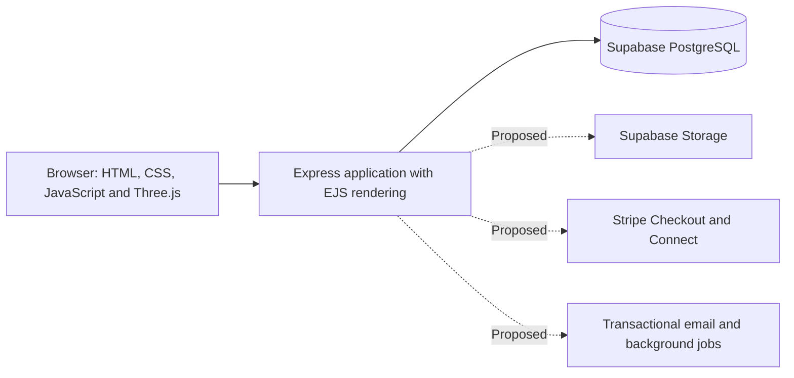

# Current system architecture

The selected stack is **Node.js + Express + EJS + Supabase PostgreSQL + Three.js**. This replaces the earlier Express/MySQL proposal.

Read [the complete system architecture](../architecture/system-architecture.md) for the full design, including authentication, product management, payment gateway selection, webhooks, stock reservations, refunds, seller payouts, storage, email, hosting and recovery.

Read [the migration and Supabase setup guide](../migration/setup-and-status.md) for implemented features, connection settings, local commands and validation limits.

The active code uses fourteen page purposes and eleven related database tables. The Supabase connection remains unconfigured until DATABASE_URL is supplied. Payment on pickup is implemented. External online payment and other service integrations are proposed, not already connected.

The existing PowerPoint file is an earlier proposal snapshot containing the original MySQL plan. Use the current Markdown architecture when describing the selected implementation.
