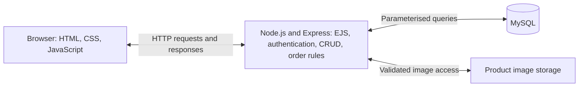
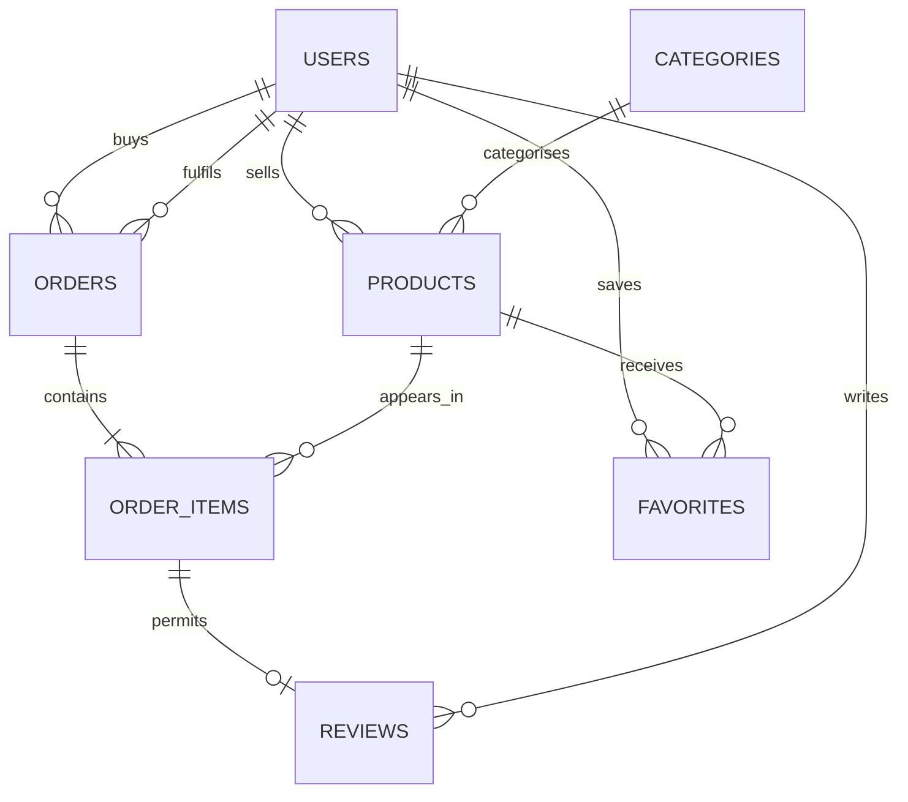

# Proposed system architecture

Status: planning only. The current website remains a local Next.js preview.

## Proposed stack

| Layer | Technology | Responsibility |
| --- | --- | --- |
| Browser | HTML, CSS and JavaScript | Display the interface and perform client-side interaction |
| Page rendering | EJS on the Express server | Produce HTML using shared layouts and database records |
| Application | Node.js with Express | Process requests, sessions, validation, permissions and order rules |
| Data | MySQL | Persist related accounts, listings, orders, reviews and saved products |
| Images | Local upload folder for the localhost demonstration | Store validated product image files, with paths referenced in the database |
| Deployment | Localhost | Demonstrate server setup and the complete application workflow |

EJS templates execute on the server. The browser receives generated HTML plus CSS/JavaScript. The application server mediates every database operation.

## Database proposal

Seven domain tables exceed the assignment's minimum of three related tables. Session infrastructure may use a separate session table and is not included in this count.

| Table | Illustrative fields | Relationships |
| --- | --- | --- |
| Users | id, name, email, password_hash, role, campus, created_at | One user owns many products and places many orders |
| Categories | id, name, description | One category contains many products |
| Products | id, seller_id, category_id, title, description, price, stock, campus, pickup_location, image_path, status | seller_id references Users; category_id references Categories |
| Orders | id, buyer_id, seller_id, status, pickup_details, total, created_at | buyer_id and seller_id reference Users |
| OrderItems | id, order_id, product_id, quantity, unit_price | References Orders and Products, preserving the agreed purchase price |
| Reviews | id, order_item_id, author_id, rating, comment, created_at | References OrderItems and Users; eligibility comes from a completed order |
| Favorites | user_id, product_id, created_at | Connects Users and Products using a composite unique key |

The MVP uses one product per order through Buy Now. OrderItems still records the product, quantity and price at purchase. A future multi-product cart can extend this model. Orders remain limited to one seller. Reviews are buyer-to-product reviews in the MVP. Mutual buyer/seller reputation and business-profile ownership require additional modelling if added later.

Use decimal money fields, unique email addresses, foreign keys, valid rating ranges and a unique review per order item. Preserve order history: remove unsold listings when allowed, but archive listings with order references rather than breaking historical records.

## Core request flows

### Product management

1. A seller signs in using a real server session.
2. The seller submits the product editor form.
3. Express validates the text, category, price, stock and uploaded image.
4. The server sets seller_id from the authenticated account, rather than trusting a form field.
5. Parameterised SQL creates or changes the seller's record.
6. A redirected product page displays the saved database result.

For updates and deletion, check ownership or administrator authority on the server. A hidden edit button is not an access-control check.

### Ordering

1. An authenticated buyer selects a product and quantity.
2. Express checks product availability, disallows buying one's own product and reads the current price from the database.
3. Within a database transaction, the server checks/locks stock and saves the order with its OrderItems record. The server calculates the total.
4. The seller progresses the order through valid statuses: pending, accepted, ready for pickup and completed. Cancellation follows defined rules and restores reserved stock exactly once when appropriate.
5. The buyer sees the order in My orders. After completion, the server permits one review of that order item.

The proposed fulfilment method is campus pickup with payment on pickup. The brief does not explicitly demand a payment gateway. Do not label an order as a successful online payment without a real gateway integration.

## Security plan

- Hash passwords using a maintained password-hashing implementation. Never store plaintext passwords.
- Use server sessions, HttpOnly cookies, suitable SameSite settings, session renewal on login and Secure cookies under HTTPS.
- Check roles and resource ownership on every protected operation. Students/staff can buy and sell. Administrators receive separate authority.
- Validate and normalise inputs on the server, parameterise database queries and escape user content when rendering HTML.
- Protect state-changing forms against CSRF and rate-limit login attempts.
- Restrict uploads by type and size, verify content, generate filenames and prevent executable files from being served as application code.
- Keep database credentials in environment configuration outside committed source files.
- If university eligibility is claimed, check the allowed domain on the server and verify email ownership before treating it as verified identity. Domain text alone is insufficient. Official university SSO is an optional integration requiring appropriate access.
- Keep any SSM/PTU badge decision on the administrator side. The current sample badges do not demonstrate official registration or institutional approval.

## Migration plan

1. Preserve the current working prototype and useful assets. The application source is not migrated by this documentation task.
2. Establish an Express entry point and EJS layouts for the 13 planned page purposes.
3. Reuse CSS, original artwork and useful browser interactions from `dist/` and `public/`, adapting DOM hooks to the page layout.
4. Replace browser-local account, listing and saved-item data with authenticated server operations and MySQL.
5. Replace simulated exchanges with persistent orders and completed-order review eligibility.
6. Retest normal navigation, validation, permissions, responsive behaviour and restart persistence.
7. Review the service worker if retaining the PWA. Avoid caching sensitive account pages, mutation responses or stale authenticated content.

The PDF permits optional frameworks. Keeping Next.js and implementing the same backend, database and page requirements is also a valid option. Express/EJS is the proposed choice because it makes the assessed backend and database flow straightforward for the group to explain and preserves much of the current HTML/CSS/JavaScript work.

Technical references: [Node.js](https://nodejs.org/learn/getting-started/introduction-to-nodejs), [Express](https://expressjs.com/), [Next.js](https://nextjs.org/docs). These support the technology definitions, not a claim that one stack automatically earns higher marks.
